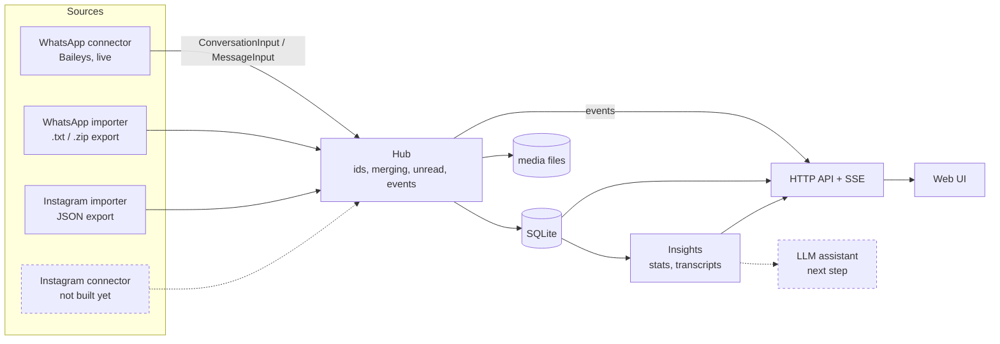

# Architecture

The goal is a messaging client where each app (WhatsApp, Instagram, later others)
is a plug-in, and everything above that plug-in layer (storage, UI, insights, the
LLM assistant) is written once against one shared data model.

## The pieces

**Domain model** (`src/core/types.ts`). `Conversation`, `Message`, `Participant`,
`Attachment`, `Reaction`, `ConnectorStatus`. A conversation has a `platform` (whatsapp,
instagram) and a `sourceId` (which connector or importer produced it) as separate
fields, so a single bridge could one day produce conversations on several platforms.
Ids are namespaced `${sourceId}:${nativeId}`, so nothing collides across sources.

**Connectors** (`src/core/connector.ts`). The contract for a live service: `start`,
`stop`, `logout`, `hasSession`, optionally `sendText`. A connector never touches the
database. It turns the service's events into `ConversationInput`/`MessageInput`/
`MessagePatch` and pushes them through a `ConnectorContext`. Edits, deletes, receipts
and reactions are all patches against an existing message.

**Importers** (`src/importers/`). They parse export files into the same inputs.
Exports have no message ids, so ids are derived from content (`assignStableIds`).
Importing a longer export of the same chat later merges into it instead of
duplicating. Sources can be a single file, a zip, or an extracted folder.

**Hub** (`src/core/hub.ts`). The one writer. It namespaces ids, creates conversations
on first sight, merges re-delivered messages without undoing edits, deletes or read
receipts, keeps unread counts and previews, routes sends to the owning connector,
and emits events. Large batches (history sync, imports) emit one `messages.bulk`
event instead of thousands.

**Store** (`src/store/db.ts`). SQLite through Node's built-in `node:sqlite`, so there
are no native modules to compile. Messages page newest-first with a
`timestamp_rowid` cursor, so messages that share a timestamp keep a stable order.

**API** (`src/server/app.ts`). REST for reads and actions, plus server-sent events
(`/api/events`) for live updates. Guards against DNS rebinding and CSRF, because a
local server that can send your messages is a target for any web page you visit.

**Insights** (`src/insights/`). Deterministic stats (message share, words, who starts
conversations, median reply time, activity by hour, weekday and month) and a plain-text
transcript formatter. The transcript is the same thing you currently export by hand,
and it's the context format the LLM layer will build on.

**Web UI** (`web/src`). React with no UI framework. One `EventSource` is shared by the
whole app. Three columns (list, thread, insights) collapse to one on a phone.

## Platform access

This is the part with real trade-offs. The architecture doesn't care which option
backs a connector, so these choices can change later.

### WhatsApp

| Option                                  | Personal account | Notes                                                                                                                          |
| --------------------------------------- | :--------------: | ------------------------------------------------------------------------------------------------------------------------------ |
| **Baileys** (linked device). **Built.** |       Yes        | Pure TypeScript, no browser. Unofficial: against WhatsApp's terms, small ban risk. History sync gives recent history, not all. |
| whatsapp-web.js                         |       Yes        | Drives real WhatsApp Web in headless Chrome. Heavier, same terms issue.                                                        |
| mautrix-whatsapp (Matrix bridge)        |       Yes        | What Beeper uses. Needs a Matrix homeserver alongside. Same terms issue, but someone else maintains the protocol work.         |
| WhatsApp Business Cloud API             |        No        | Official, but only for business numbers. Can't read your personal chats.                                                       |
| **Chat export import.** **Built.**      |       Yes        | Always works and fully compliant. Read-only snapshot.                                                                          |

### Instagram DMs

| Option                                  | Personal account | Notes                                                                                                                                                                                                                        |
| --------------------------------------- | :--------------: | ---------------------------------------------------------------------------------------------------------------------------------------------------------------------------------------------------------------------------- |
| **Data export import.** **Built.**      |       Yes        | Always works, compliant, full history. Read-only snapshot; Meta's JSON needs a mojibake fix (handled).                                                                                                                       |
| Instagram API with Instagram Login      |        No        | Official. Needs a professional (Creator/Business) account, which can't be private. Replies only within 24h of their last message. Incoming messages arrive by webhook, so it needs a public URL (a tunnel). Limited history. |
| mautrix-meta (Matrix bridge)            |       Yes        | Most robust unofficial option, actively maintained, full backfill. Needs a Matrix homeserver. Against Meta's terms.                                                                                                          |
| instagrapi (Python, private mobile API) |       Yes        | Polling only, frequent login challenges, higher ban risk.                                                                                                                                                                    |

**Open decision.** Which live Instagram path do you want? If the account is or can be
professional and public, the official API is the safe choice. If it's a personal
account, a Matrix bridge is the realistic path. Picking the bridge also opens the
option of moving WhatsApp onto `mautrix-whatsapp`, giving one integration path for
every platform. That costs running a homeserver and two bridges, probably with
docker-compose.

## The LLM layer (next)

What you do today (export, then ask questions of the file) maps onto three features:

1. **Ask about this conversation** in the insights panel: dynamics, summaries, "what
   did we decide about X". Context = the deterministic stats + a transcript window.
   Long chats need retrieval rather than the whole history: SQLite FTS5 for keyword
   search, embeddings later, or rolling per-month summaries cached in the database.
2. **Inline nuance and translation**: an action on a message that explains tone,
   slang or cultural context, or translates, using the surrounding messages as context.
3. **Catch-up and drafting**: summarise unread across conversations, and suggest
   replies you edit before sending. Never auto-send.

The plan is an `assistant` module beside `insights/` with one entry point,
`ask(conversationId, question, { range })`. It builds context from the store, calls the
model, and streams the answer over the existing SSE channel. Answers can be cached per
conversation.

Before building it, decide:

- **Hosted or local model.** A hosted model (Claude through the Anthropic API) gives
  the best quality on long, subtle conversations, but your chats leave the machine.
  A local model (Ollama, etc.) keeps everything local, at lower quality.
- **Other people's messages.** Your chats contain what other people said. Keep the
  assistant opt-in per conversation, and make clear what gets sent.

## Known limitations

- WhatsApp is moving 1:1 chats to opaque LIDs. The connector maps LIDs to phone
  numbers when WhatsApp tells it the mapping. If it doesn't, one person can briefly
  appear as two chats.
- Only live images, stickers and voice notes are downloaded automatically. Synced
  history shows media as placeholders.
- Imported conversations don't merge with the live conversation for the same person
  yet. Exports identify people by display name, live chats by phone number, so
  linking them needs a "this is the same person" step.
- Export timestamps carry no time zone and are read as this machine's local time.
- There is no authentication, so keep the default `127.0.0.1` binding.
