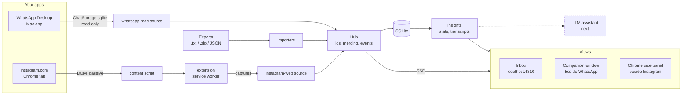

# Architecture

Inbox sits on top of the messaging apps you already use. It reads what they show or
store on your computer, keeps it in one local database, and puts insights beside the
conversation you're in. It never talks to WhatsApp's or Instagram's servers and never
sends anything. You chat in the apps.

## Core

**Domain model** (`src/core/types.ts`). `Conversation`, `Message`, `Participant`,
`Attachment`, `Reaction`, `ConnectorStatus`. A conversation has a `platform` and a
`sourceId` (which source produced it). Ids are namespaced `${sourceId}:${nativeId}`.
Live conversations list "You" as a participant with id `me`.

**Sources** (`src/core/connector.ts`). A source mirrors an app that is already running:
`shouldAutoStart`, `start`, `stop`. It may also serve the app's own media files
(`mediaFile`), or accept pushes from the extension (`receive`, `heartbeat`). Sources start
side by side, so a long first read in one never holds up another. A source
never touches the database. It reports `ConversationInput`, `MessageInput` and
`MessagePatch` to the hub.

**Hub** (`src/core/hub.ts`). The one writer. It creates conversations on first sight and
merges re-read messages without undoing edits or deletes. A source that mirrors an app's
own store (WhatsApp) is _authoritative_: its text replaces the stored text, and a change
is an edit. A reported reaction list replaces the stored one; an absent list keeps it.
Lower-priority copies can be written `onlyIfNew`. The hub mirrors an app's own unread
counts when the source knows them, and skips the write and the event when a re-read row
hasn't changed. Large batches emit one `messages.bulk` event. When an app learns that two
ids are one person, `retireConversation` folds the old conversation into the new one,
keeping its group and any messages the new one lacks.

**Store** (`src/store/db.ts`). SQLite through Node's built-in `node:sqlite`, so there's
nothing native to compile. Newest-first pagination uses a `timestamp_rowid` cursor.

**API** (`src/server/app.ts`). REST plus server-sent events. It binds to `127.0.0.1`,
rejects unknown `Host` headers and cross-site writes, and accepts the extension's
`chrome-extension://` origin only on `/api/connectors/:id/{captures,heartbeat}` (optionally
pinned with `EXTENSION_ID`). HTML is served with `frame-ancestors 'self'` plus the
extension (just the pinned id when `EXTENSION_ID` is set). Media streams with HTTP range
support and `Cross-Origin-Resource-Policy: same-origin`, so other sites can't embed it.

## WhatsApp Desktop (macOS)

`src/connectors/whatsapp-mac/`.

WhatsApp for Mac is a Mac Catalyst app (bundle `net.whatsapp.WhatsApp`; the Electron app
was retired in 2024). It keeps an iPhone-style Core Data store, unencrypted, in
`~/Library/Group Containers/group.net.whatsapp.WhatsApp.shared/`:

- `ChatStorage.sqlite` (WAL mode): `ZWACHATSESSION`, `ZWAMESSAGE`, `ZWAGROUPMEMBER`,
  `ZWAMEDIAITEM`, `ZWAPROFILEPUSHNAME`, `ZWAMESSAGEINFO`
- `ContactsV2.sqlite`: `ZWAADDRESSBOOKCONTACT`, saved names, including by LID
- `LID.sqlite`: `ZWAZACCOUNT`, mapping opaque `@lid` ids to phone numbers

How the reader works:

- **Opening.** A read-only connection with `query_only` and a 5 s busy timeout. Each read
  is one short transaction, so WhatsApp's checkpoints are never held up. `immutable` is
  never used: the newest rows live in the WAL.
- **History.** Start reads everything, in batches of 2,000 rows in the background, yielding
  between batches so the server stays responsive. It always starts over, since the store
  may have been recreated (signed out and linked again) and re-reading unchanged rows
  costs no writes. Rows that don't map (status updates, hidden chats) still move the
  cursor on.
- **Change detection.** `PRAGMA data_version` is polled every 1.5 s. On a change it reads
  rows above the last `Z_PK`, then re-reads the newest 300 rows to catch edits, deletes
  and reactions, which rewrite rows in place. A text change marks an edit; type 14 marks
  deleted for everyone. Reactions on older messages update on the next start.
- **New and changed chats.** The chat list is read in the same transaction as any
  message that names a chat it hasn't seen, so a chat created mid-read keeps its first
  messages. A chat that is unhidden, or that is now known by its phone number, has its
  older rows read again.
- **Schema guard.** It builds every query from the columns that exist. If a required
  column is missing it refuses with the column's name rather than misreading.
- **Identity.** Group senders are mostly `@lid`. The reader folds LIDs into phone-number
  JIDs via LID.sqlite and contacts, so one person is one person. Those files are watched
  (WAL included): when WhatsApp learns a number, the LID chat folds into the phone-number
  conversation (keeping its group) and group messages from that person are re-read
  under the new id. Message ids are (direction, stanza id). History-sync rows
  (`ZSORT < 0`) are usually the only copy; when a regular row exists too, it wins.
- **Names.** Saved contact, then chat name, then group member record, then push name.
- **Extras.** Unread counts mirror the app (`-1` means marked unread). Community
  announcement groups (session type 4) count as groups, and calls (type 59) show as a
  line in the thread. Reactions are decoded from the `ZRECEIPTINFO` protobuf, keeping each
  sender's latest. Replies come from the media item's `ZMETADATA` protobuf (field 5 is
  the quoted stanza id, field 6 its sender), even for plain text; `ZPARENTMESSAGE` links
  album items, not replies. Media is linked only when the file is really on disk; most
  of it isn't, and iCloud-style placeholder stubs, which block on read, are skipped.
- **Permissions.** macOS 15+ protects app group containers. The first read triggers "would
  like to access data from other apps", and an Allow lasts only for that process. Full
  Disk Access on the launching app (Terminal, …) is the lasting fix.

Sources: six-plus open-source readers of this exact store updated in Sept–Oct 2026
(openclaw/wacrawl, ezzabuzaid/elt, arraypress/swift-whatsapp-messages, kenn-io/msgvault,
stacksjs/stacks, raycast/extensions), Mysk's 2024 and 2026 disclosures, Apple's macOS 15
release notes, and SQLite's WAL/URI docs. An independent fact-check confirmed the
paths, tables, unread and session-type codes, message types 0–15 and the reactions
layout, and corrected the reply source. Edit detection and type codes past 15 are
best-effort.

## Instagram in Chrome

`extension/` (MV3), `src/connectors/browser/`.

As of October 2026, Instagram web no longer uses Messenger's protocol: it moved DMs to a
new GraphQL-plus-binary-WebSocket stack in June 2026. It also dropped end-to-end
encryption for DMs in May 2026. The wire formats are undocumented and change often, so
the extension reads the **DOM**:

- **Thread id:** `/direct/t/<thread id>/`.
- **Messages:** `div[role="article"]` inside `div[role="group"]` (or `role="row"`) rows,
  or `[role="presentation"]` bubbles on accounts with the other layout. Text comes from
  `dir="auto"` leaves. Class names are never used.
- **Your messages:** they hug the right edge of their row. That's geometry, so it assumes
  a left-to-right UI language.
- **Times:** only from the centred divider rows ("Today 10:42", "3 Oct 2026"), in English.
- **The list:** it's a `column-reverse` scroller that renders about 20 bubbles at a time.

The content script is passive by default: no requests, no clicks, no DOM edits. It sends
a snapshot of the visible window to the service worker whenever the page settles. The
worker posts it to the local server. Extension pages are exempt from Chrome's Local
Network Access prompts; content scripts are not, which is why the page never calls
`localhost` itself.

**Stitching windows together** (`align.ts`). The page has no message ids, and each
capture is a ~20-message slice. Each message gets a signature: direction, text and
attachment types. Sender names are left out because they're inferred from avatars that
come and go. Each capture is placed against the whole stored thread:

- **Placing it.** A local alignment (Smith-Waterman) finds the best-scoring contiguous
  stretch. It needs at least two exact matches, so a lone "ok" can't pin a window to some
  old "ok". Ties go to the newest stretch.
- **Inside the stretch.** Stored messages missing from the window (media still loading)
  are tolerated. A same-side message that changed in place is an edit of the stored one,
  not a new message.
- **New messages** get ids anchored to the stored message before them. Their times sit
  strictly between their stored neighbours: the page's divider time if there is one;
  otherwise they follow the message before them by 100 ms, so no reply time is invented.
  A message that arrives below the last stored one while you watch is dated "now",
  rather than by a divider from hours ago. Nothing is dated in the future.
- **A window that can't be placed** is stored only when the extension says it's the
  newest part of the thread (`atBottom`). Otherwise it's skipped, because guessing would
  duplicate history.

A thread that the page has shown as a group stays a group, and in a group a message the
page could only attribute to the thread's title keeps its stored sender.

**Read earlier messages** is the one exception to passive reading, and only when you
click it. It scrolls the thread back by ¾ of a screen, waits 1.5 s plus Instagram's
loading skeleton, and stops at 40 steps or when nothing moves three times in a row.

**Side panel.** A thin frame around the local app's companion view (`/?view=companion
&embed=extension`), told by the extension which thread the active tab has open. It
offers "Read earlier messages" and "Check reader" (a diagnostic snapshot of what the
reader sees, for when Instagram changes its markup).

## Views

- **Inbox** (`/`): every conversation, with the thread, insights and imports.
- **Companion** (`/?view=companion`): a narrow view for beside an app.
  - **Follow** switches to the chat you just sent a message in.
  - **Float** opens it in Chrome's Document Picture-in-Picture, so it stays above every
    app with nothing to install.
  - Inside the extension's side panel, focus comes from the extension instead.

## Groups

`src/core/groups.ts` (shared by server and web), `src/insights/groups.ts`.

A conversation stores an assigned group (`close`, `romantic` or `ghosts`), an optional
`dateAt` and `groupSetAt`. The group you see is derived from those, the newest message
time and the current time, so nothing has to run on a timer:

- **Close friends** is the default.
- **Dates** applies while a scheduled date is less than 12 hours past its start.
  Scheduling one moves the conversation to romantic interests underneath, so it falls
  back there afterwards.
- **Ghosts** applies to a romantic interest when 48 hours have passed since the latest of
  the last message, a past date, or the move. A conversation moved to Ghosts by hand
  stays there until someone writes after the move.

Alerts are a per-group setting (`settings` table), on for Close friends and Dates.
Desktop notifications come from an open Inbox or Companion window, only for live
messages from others, deduplicated by message id. Each group's insights card shows
different metrics:

- **Close friends:** keeping in touch.
- **Romantic interests:** balance and momentum over 30 days.
- **Dates:** the lead-up.
- **Ghosts:** the shape of the silence.

The move menu opens on a long press (500 ms, cancelled by moving), a right-click, or
Shift+F10. On phones it's a bottom sheet.

## Insights

`src/insights/`.

Deterministic stats: message share, words, who starts conversations (after 6 h of
silence), median reply time, and activity by hour, weekday and month. Reply gaps of a
second or less are ignored, because they come from coarse clocks (minute-precision
exports, Instagram's dividers, where messages are spaced 100 ms apart to keep order)
rather than real replies. A transcript formatter produces the same plain text you'd
paste into a model.

## Next

1. **Follow the chat that's open in WhatsApp, not just the one you last sent in.**
   WhatsApp for Mac exposes the open chat's name through Accessibility
   (`AXIdentifier == "NavigationBar_HeaderViewButton"`). A small helper with
   Accessibility permission can poll it. This needs a Mac to build and test.
2. **The LLM layer.** "Ask about this conversation" in the insights panel. "Explain or
   translate this message" with its surrounding context. Catch-up summaries. Context is
   the stats plus a transcript window, with retrieval for long histories. Decide hosted
   (best quality; chats leave the machine) vs local, and keep it opt-in per conversation.
3. **Drafts.** Insert a suggested reply into Instagram's composer (a Lexical editor;
   `execCommand('insertText')` is the reported working path), or copy it for WhatsApp.
   Never send, and never synthesize Enter.
4. **More surfaces.** The same extension can read web.whatsapp.com. On Windows, WhatsApp
   Desktop is now WhatsApp Web inside WebView2, which extensions can't reach.

## Known limitations

- The WhatsApp Desktop store is a linked-device cache: partial history, mostly
  undownloaded media.
- Instagram reading depends on markup that changes. "Check reader" shows when it breaks.
- Instagram times are approximate between dividers, and view-once messages aren't visible
  on the web.
- Imported conversations don't merge with live ones for the same person yet.
- There is no authentication, so keep the `127.0.0.1` binding.
